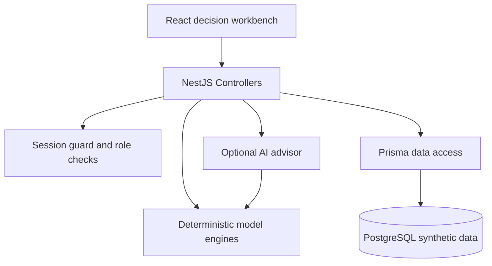

# VinMec DSS — modular decision-support architecture

> Academic independent prototype, synthetic outpatient aggregates only. No real Vinmec affiliation, clinical approval, or hospital integration.

## Reference architecture and rationale

The DSS is a **modular monolith** with five logical concerns, rather than a distributed microservice system. This preserves a single deployment, database transaction boundary and predictable local setup while separating the components needed for an actual decision-support workflow.

| DSS concern | Concrete implementation | Scope |
|---|---|---|
| Presentation and dialogue | `apps/web/src` (React) | Input, charts, scenarios, model transparency, human review |
| Application and decision workflow | NestJS controllers under `apps/api/src/modules` | API endpoints, role checks, scenario/decision persistence |
| Model management | `apps/api/src/models/model.catalog.ts`, `dss.engine.ts`, `planning.engine.ts`, `forecast.metrics.ts` | Deterministic calculations, forecast baselines, model metadata |
| Knowledge and AI explanation | `ai.advisor.ts`, `ai.workflow.ts`, protected API | Optional LLM explanation grounded on computed aggregate evidence |
| Data and governance | Prisma schema, PostgreSQL, authentication guard, tests | Synthetic historical aggregates, decisions, model results and role gates |

This mapping draws on classic DSS **data / model / dialogue management** and decision workflow design. No external DSS code was copied.

## Dependency direction



Controllers coordinate requests; calculations must remain in deterministic pure functions independent of NestJS or the OpenAI SDK. The OpenAI key is read server-side only. AI responses must not write decisions, mutate numeric recommendations or claim clinical validation.

## Source tree

```text
apps/
  api/
    src/
      server.ts                      # NestJS composition root
      main.ts                        # bootstrapping and common middleware
      contracts/dto.ts               # validated inbound DTOs
      infrastructure/database.ts     # Prisma provider
      security/
        auth.controller.ts           # sign-in and status
        jwt.guard.ts                 # token and active-user verification
      shared/request-context.ts      # date validation, principal, manager check
      modules/
        public/public.controller.ts  # no-write public synthetic analytics
        health/health.controller.ts  # database health
        decisions/dss.controller.ts  # protected decision lifecycle and AI
      models/model.catalog.ts        # model transparency and governance
      dss.engine.ts                  # legacy three-option rule
      planning.engine.ts             # capacity enumeration (lab)
      forecast.metrics.ts            # rolling backtest
      ai.advisor.ts                  # structured advisor
      ai.workflow.ts                 # conversational intent and verified What-if
    prisma/schema.prisma
    test/
  web/
    src/
      App.tsx
      components/
        OperationsDashboard.tsx
        CapacityPlanningLab.tsx
        AiWorkspace.tsx
        OperationsAnalytics.tsx
        StaffLogin.tsx
      lib/api.ts
      style.css
docs/
  CAPACITY_LAB.md
  DSS_ARCHITECTURE.md
  OUTLINE_MAPPING.md
```

## Public and protected API boundaries

| Surface | Authorization | Persistence | AI |
|---|---|---|---|
| `GET /api/public/summary`, `forecast-quality` | Public | Read only | None |
| `POST /api/public/forecast`, `evaluate`, `capacity-lab` | Public | No | None |
| `GET /api/public/model-catalog` | Public | No | None |
| `POST /api/forecasts/run`, `scenarios` | Staff except scenario restriction on admin | Yes | None |
| `POST /api/decisions` | Manager only | Yes, single finalization | None |
| `POST /api/ai/converse/:id`, `scenarios/:id/insights` | Staff only | Conversation response; some insights stored | Optional and bounded |

## Decision traceability

1. Inputs: synthetic visits and assumed available resources.
2. Model: algorithm ID, assumptions, explicit calculation method and quality metric.
3. Outputs: forecast or staffing alternatives, candidate shortfall, capacity and cost.
4. Decision: authorized manager records action and rationale with timestamp.
5. AI: model-generated narrative is tagged and not treated as verified numerical evidence.

**Important:** the model registry currently documents implementations and versions; individual scenario records do not yet store a model-version FK or complete immutable input snapshot for every downstream analysis. Production traceability needs this and a formal migration.

## Limitations and recommended next milestones

- The existing protected scenario flow still uses the **three-option heuristic**; the lab is a separate read-only enumerative engine. They must not be mislabeled as identical.
- The enumeration covers only one bounded integer resource decision. No specialty, shift or skill scheduling has been implemented.
- The backend module split is a first refactor; the protected controller remains large and needs extraction into application services and persistence repositories.
- The React App and CSS remain largely monolithic, so a subsequent slice should separate route/pages and a design-system layer.
- No real hospital data, enterprise SSO, MFA, integration, clinical safety evaluation or multi-instance rate limiting.
- A deployable CI build is not proof of operational readiness.

## References

- Google OR-Tools employee scheduling: https://developers.google.com/optimization/scheduling/employee_scheduling
- OHDSI open-source software and ATLAS ecosystem: https://www.ohdsi.org/software-tools/
- Microsoft Azure architecture center: https://learn.microsoft.com/en-us/azure/architecture/
